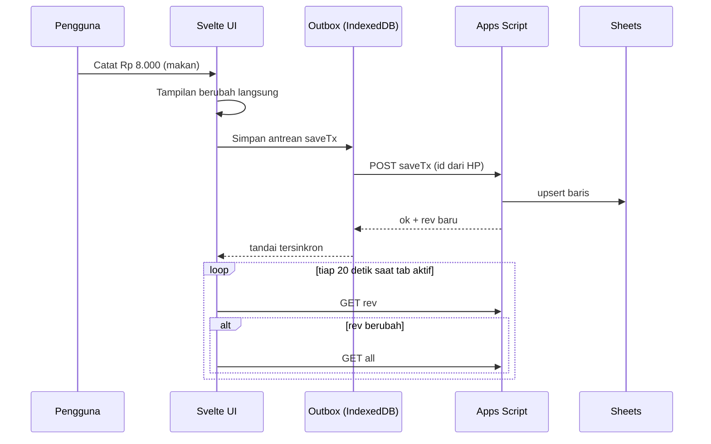

# PRD — Neko Dompet

Finance tracker pribadi untuk uang jajan mingguan. Mobile-first, terasa real time, bertema kucing bergaya Ghibli-inspired, dengan Google Sheets sebagai database.

## Status dokumen

| Tahap | Isi | Status |
|---|---|---|
| 1 | Fondasi: visi, design system, arsitektur, data, navigasi | **Disetujui** |
| 2 | Fitur inti: Beranda, Tambah transaksi, Pengaturan budget, rumus | **Disetujui** |
| 3 | Tabungan/Goals dan Statistik (donut interaktif) | **Disetujui** |
| 4 | Kucing reaktif, streak, dunia dinamis, lencana, fase berikutnya, uji akhir | **Disetujui** |

Aturan kerja: satu tahap ditulis, ditinjau, disetujui, baru tahap berikutnya.

---

# TAHAP 1 — FONDASI

## 1. Visi dan tujuan

### 1.1 Visi
Mencatat uang jajan terasa seperti merawat kucing peliharaan: ringan, menyenangkan, dan membuat kita mau kembali tiap hari.

### 1.2 Masalah yang diselesaikan
- Aplikasi keuangan biasa terasa kaku sehingga cepat ditinggalkan.
- Uang jajan mingguan kecil dan habis tanpa terasa karena tidak ada gambaran "boleh jajan berapa hari ini".
- Data di aplikasi lain tidak bisa diubah atau dilihat langsung sesuai keinginan.

### 1.3 Tujuan produk
| # | Tujuan | Ukuran keberhasilan |
|---|---|---|
| T1 | Mencatat cepat | Satu transaksi selesai maksimal 3 ketukan dan di bawah 5 detik |
| T2 | Terasa real time | Tampilan berubah dalam < 100 ms setelah input, tanpa menunggu server |
| T3 | Menyenangkan | Setiap aksi penting punya respons visual dari kucing |
| T4 | Data milik sendiri | Seluruh data terlihat dan bisa diedit langsung di Google Sheets |
| T5 | Ringan | JS awal ≤ 80 KB gzip, terbuka dari cache < 1 detik |

### 1.4 Bukan tujuan (di luar cakupan)
Multi-pengguna, impor mutasi bank, multi-mata uang, foto struk, dan laporan pajak.

---

## 2. Pengguna dan konteks pakai

**Pengguna utama:** satu orang (pemilik), pelajar/remaja dengan uang jajan mingguan Rp 145.000, memakai HP Android atau iOS.

**Konteks pakai:**
- Dipakai sambil berdiri atau berjalan, satu tangan, sering di sinyal lemah.
- Sesi sangat singkat (5–15 detik) berkali-kali sehari.
- Dibuka dari ikon layar utama (PWA), bukan dari browser.

**Dampak ke desain:**
- Tombol utama di jangkauan ibu jari (bagian bawah layar).
- Semua aksi tulis harus bisa dilakukan offline.
- Tidak ada layar yang butuh banyak mengetik.

---

## 3. Peta cakupan

| Fitur | Fase | Tahap PRD |
|---|---|---|
| Beranda (ringkasan + daftar transaksi per hari) | MVP | 2 |
| Tambah transaksi (keluar, masuk, tabung) | MVP | 2 |
| Pengaturan budget kategori | MVP | 2 |
| Sinkron Google Sheets + offline | MVP | 1 (dasar), 2 (perilaku) |
| Tabungan / Goals | MVP | 3 |
| Statistik, donut chart interaktif | MVP | 3 |
| Kucing reaktif | MVP | 4 |
| Sisa hari ini | MVP | 2 (rumus), 4 (reaksi kucing) |
| Streak hari hemat | MVP | 4 |
| Dunia yang berubah sesuai jam | MVP | 4 |
| Lencana pencapaian | MVP | 4 |
| Pengingat malam, ringkasan mingguan, carry-over, mode gelap | Fase 2 | 4 |

---

## 4. Design system

Referensi gaya: dua tampilan Goals (kartu pastel dengan tepi bawah tebal, tombol timbul, chip nominal cepat) dan tampilan Record (latar krem hangat, maskot kucing, daftar transaksi berwarna per kategori). Digabung dengan nuansa Ghibli-inspired: lembut, hangat, alam.

### 4.1 Prinsip
1. **Lembut, bukan ramai.** Pastel hangat, satu elemen menonjol per layar.
2. **Timbul seperti stiker.** Kartu dan tombol punya tepi bawah tebal, bukan bayangan kabur.
3. **Kucing adalah antarmuka.** Status keuangan disampaikan lewat ekspresi, bukan hanya angka.
4. **Gerak menjawab sentuhan.** Animasi muncul sebagai respons aksi; gerak otomatis hanya sedikit dan pelan.
5. **Orisinal.** Kucing dan ilustrasi buatan sendiri, tidak memakai karakter atau gambar milik Studio Ghibli.

### 4.2 Warna

**Dasar**
| Token | Nama | Hex | Pemakaian |
|---|---|---|---|
| `--bg` | Krem pagi | `#F8F0E0` | Latar halaman |
| `--card` | Kertas | `#FFFDF7` | Kartu netral, bottom sheet |
| `--ink` | Cokelat tinta | `#4A3B32` | Teks utama |
| `--mute` | Cokelat pudar | `#8C7B6E` | Teks sekunder |
| `--line` | Garis krem | `#EADFCB` | Pembatas, track progress |
| `--accent` | Jingga kucing | `#E59A6A` | Tombol utama, fokus, aksen |
| `--sky` | Langit | `#BFE0E6` | Latar dunia kucing |
| `--grass` | Rumput | `#B5D6A0` | Latar dunia kucing |

**Status**
| Token | Hex | Arti |
|---|---|---|
| `--good` | `#8DBF7A` | Aman (sisa > 35%) |
| `--warn` | `#E9B65A` | Hati-hati (10–35%) |
| `--bad` | `#D9776B` | Kritis (< 10%) atau terlampaui |

**Warna kategori** (isi kartu pastel + tepi bawah lebih gelap)
| Kategori | Ikon | Isi | Tepi |
|---|---|---|---|
| Jajan & makan | 🍙 | `#FBE0D3` | `#F2B28C` |
| Pulsa | 📱 | `#DCEEF7` | `#9CC5D9` |
| Bensin | ⛽ | `#E4F2DA` | `#9FC88A` |
| Jajanin | 🎁 | `#EBE0F5` | `#C9B0E0` |
| Nabung | 🐷 | `#FBE1E7` | `#F2B8C6` |
| Uang jajan (masuk) | 💰 | `#FBF0CF` | `#F4D58D` |

Kategori baru buatan pengguna memilih satu pasang isi/tepi dari daftar ini. Teks selalu `--ink` di atas isi pastel (kontras terpenuhi).

### 4.3 Tipografi
- Keluarga: **Zen Maru Gothic** (bulat, ramah), cadangan `system-ui, sans-serif`.
- Bobot: 400 (isi), 700 (angka dan judul).
- Angka uang memakai `font-variant-numeric: tabular-nums` agar rata.

| Peran | Ukuran | Bobot |
|---|---|---|
| Angka besar (sisa) | 36 px | 700 |
| Judul layar | 20 px | 700 |
| Angka kartu | 20 px | 700 |
| Teks isi | 16 px | 400 |
| Teks kecil | 13 px | 400 |

### 4.4 Bentuk dan kartu bertepi tebal
- Radius: kartu 22 px, tombol 16 px, chip dan bar 999 px, bottom sheet 28 px di atas.
- Spasi memakai kelipatan 4 px; jarak antar kartu 12 px; padding layar 14 px.
- Area sentuh minimal 44 × 44 px.

Anatomi kartu:

```
┌──────────────────────────────┐
│  🍙  Jajan & makan      62%  │   isi pastel kategori
│  ▓▓▓▓▓▓▓▓▓░░░░░░             │   progress bar bulat
│  Rp 45.000 / Rp 72.500       │   angka tebal / limit tipis
└──────────────────────────────┘
██████████████████████████████████  tepi bawah 5 px, warna tepi kategori
```

Tombol utama: isi `--accent`, teks putih, tepi bawah 4 px `#C97C4E`. Saat ditekan: turun 3 px dan tepi menipis (efek tertekan).

### 4.5 Komponen dasar
| Komponen | Keterangan |
|---|---|
| Kartu kategori | Anatomi di atas, dipakai Beranda, Statistik, Pengaturan |
| Chip | Pilih kategori dan nominal cepat; terpilih = tepi `--accent` + isi tipis |
| Tombol utama / sekunder | Utama bertepi tebal; sekunder garis putus-putus |
| Bottom sheet | Naik dari bawah untuk Tambah transaksi; bisa ditarik turun untuk menutup |
| Bar progress | Tinggi 12 px, bulat, isi berubah warna sesuai status |
| Baris transaksi | Ikon kategori, nama, jam, nominal; warna isi mengikuti kategori |
| Penanda sinkron | Titik kecil di header: hijau tersinkron, kuning menyimpan, abu offline |

### 4.6 Maskot dan ilustrasi
- Kucing jingga-krem berbentuk bulat, mata besar, dibuat sebagai SVG orisinal.
- Latar dunia: langit gradasi, awan, bukit rumput berlapis (sudah dicoba di demo awal).
- Ikon kategori memakai emoji sebagai awal; bisa diganti ilustrasi buatan sendiri tanpa mengubah kode.

### 4.7 Aturan gerak
| Jenis | Durasi | Aturan |
|---|---|---|
| Respons sentuhan | 150–250 ms | Tombol tertekan, chip terpilih |
| Transisi layar/sheet | 250–350 ms | Ease-out, tanpa pantulan berlebihan |
| Reaksi kucing | 500–1500 ms | Hanya setelah aksi pengguna |
| Gerak otomatis | Lambat (40 dtk+) | Hanya awan, kedip mata, ekor |

Semua animasi nonesensial dimatikan jika `prefers-reduced-motion` aktif.

### 4.8 Aksesibilitas
- Kontras teks minimal 4.5:1.
- Informasi tidak hanya lewat warna: status juga punya teks ("Kucing mulai cemas").
- Fokus keyboard terlihat; semua tombol punya label.
- Angka uang selalu ditulis lengkap (`Rp 72.500`), tidak disingkat.

---

## 5. Arsitektur

### 5.1 Gambaran

```
┌────────────────────────────┐        ┌────────────────────────┐
│  HP (PWA, Svelte)          │        │  Google                │
│  ┌──────────────────────┐  │  HTTPS │  ┌──────────────────┐  │
│  │ UI + store reaktif   │  │◄──────►│  │ Apps Script Web  │  │
│  ├──────────────────────┤  │        │  │ App (Code.gs)    │  │
│  │ Cache + Outbox       │  │        │  └────────┬─────────┘  │
│  │ (IndexedDB)          │  │        │           │            │
│  ├──────────────────────┤  │        │  ┌────────▼─────────┐  │
│  │ Service Worker       │  │        │  │ Google Sheets    │  │
│  └──────────────────────┘  │        │  └──────────────────┘  │
└────────────────────────────┘        └────────────────────────┘
```

### 5.2 Teknologi
| Lapisan | Pilihan | Alasan |
|---|---|---|
| UI | SvelteKit + `adapter-static` (mode SPA) | Bundel kecil, reaktivitas bawaan |
| PWA | `vite-plugin-pwa` | Install ke layar utama, cache offline |
| Penyimpanan lokal | IndexedDB (via pembungkus kecil) | Cache data dan antrean kirim |
| Backend | Google Apps Script Web App | Gratis, tanpa server |
| Database | Google Sheets | Data terlihat dan bisa diedit langsung |
| Hosting | Hosting statis gratis (mis. Cloudflare Pages / Netlify) | Sederhana |

### 5.3 Struktur proyek (rencana)
```
src/
  lib/
    api.js            # GET all/rev, POST aksi ke Apps Script
    sync/outbox.js    # antrean, retry, status sinkron
    stores/           # data, minggu berjalan, status
    week.js           # aturan minggu & tanggal
    money.js          # format Rp, pembulatan
    components/       # Cat, Card, Chip, BottomSheet, Donut, ...
  routes/
    +page.svelte           # Beranda
    statistik/+page.svelte
    tabungan/+page.svelte
    pengaturan/+page.svelte
```

### 5.4 Model data di Sheets
Sesuai `Code.gs`. Semua sheet punya baris pertama sebagai header.

**`Transaksi`**
| Kolom | Tipe | Keterangan |
|---|---|---|
| `id` | teks | Dibuat di HP, mis. `tx_lq3k9a_x7f2` |
| `tanggal` | teks ISO | `2026-10-13T14:59:00+07:00` |
| `tipe` | teks | `keluar` / `masuk` / `tabung` |
| `kategori_id` | teks | Merujuk `Budget.id` |
| `nominal` | angka | Rupiah bulat, selalu positif |
| `catatan` | teks | Opsional |
| `goal_id` | teks | Diisi bila `tipe = tabung` untuk sebuah target |

**`Budget`** (kategori)
| Kolom | Keterangan |
|---|---|
| `id`, `nama`, `ikon`, `warna` | Identitas dan tampilan |
| `limit_mingguan` | Batas per minggu (untuk `masuk`: jumlah yang diharapkan) |
| `tipe` | `keluar` / `masuk` / `tabung` |
| `urut` | Urutan tampil |

**`Goals`**: `id`, `nama`, `ikon`, `warna`, `target`, `dibuat`.
Jumlah terkumpul **tidak disimpan**; dihitung dari transaksi `tabung` ber-`goal_id`.

**`Setting`**: pasangan `key`/`value` (`uang_jajan_mingguan`, `awal_minggu`, serta `saldo_awal` dan `tanpa_jajan` yang opsional; `saldo_awal` bawaan 0).

Data awal (hasil `setup()`):

| Kategori | Tipe | Mingguan |
|---|---|---|
| Jajan & makan | keluar | 72.500 |
| Pulsa | keluar | 4.000 |
| Bensin | keluar | 25.000 |
| Jajanin | keluar | 14.500 |
| Nabung | tabung | 29.000 |
| Uang jajan | masuk | 145.000 |

Pemeriksaan: 72.500 + 4.000 + 25.000 + 14.500 + 29.000 = 145.000. Bulanan (× 4): 580.000.

### 5.5 Model data di klien
Sama dengan Sheet, ditambah penanda lokal yang tidak dikirim ke server:
`_sync: 'pending' | 'ok' | 'error'`.

### 5.6 Sinkron dan offline



Aturan:
1. **Optimistic UI.** Perubahan langsung tampil, lalu dikirim di belakang.
2. **Outbox.** Setiap aksi tulis masuk antrean di IndexedDB sebelum dikirim; bertahan walau aplikasi ditutup.
3. **Aman dikirim ulang.** ID dibuat di HP dan server memakai upsert, sehingga kirim ulang tidak membuat data ganda.
4. **Retry.** Gagal → coba lagi dengan jeda 2, 5, 15, 60 detik, dan langsung mencoba saat event `online`.
5. **Polling hemat.** Hanya `GET rev` tiap 20 detik saat tab terlihat; berhenti saat tab tersembunyi. `GET all` hanya bila revisi berubah.
6. **Konflik.** Yang terakhir menulis menang. Untuk satu pengguna ini cukup.
7. **Buka aplikasi.** Tampilkan cache dulu, lalu segarkan dari server.
8. **Penanda sinkron** di header menunjukkan status (tersinkron / menyimpan / offline).

Catatan batas: respons Apps Script biasanya 1–3 detik, jadi "real time" dicapai lewat optimistic UI + polling, bukan koneksi langsung.

### 5.7 Konvensi
- **Mata uang:** Rupiah bulat (tanpa desimal), format `Rp 72.500`.
- **Zona waktu:** WIB (UTC+7); tanggal disimpan ISO dengan offset.
- **Minggu:** mulai dari hari yang ditentukan `awal_minggu` (bawaan Senin), berakhir 7 hari kemudian. Dipakai untuk reset budget. Rumus rinci ada di Tahap 2.
- **Bulan:** hanya tampilan informasi (≈ 4,3 minggu); budget tetap dihitung per minggu.

---

## 6. Navigasi dan peta layar

```
        ┌───────────────────────────────┐
        │ ● tersinkron      Neko Dompet │
        │                               │
        │         (isi layar)           │
        │                               │
        │                               │
        ├───────────────────────────────┤
        │ 🏠     📊     (＋)    🐷     ⚙️ │
        │Beranda Statistik Tambah Tabungan Atur │
        └───────────────────────────────┘
```

| Tab | Layar | Tahap PRD |
|---|---|---|
| Beranda | Ringkasan, kucing, daftar transaksi per hari | 2 |
| Statistik | Donut chart dan rincian kategori | 3 |
| Tambah (tombol tengah menonjol) | Bottom sheet input transaksi | 2 |
| Tabungan | Daftar Goals, detail Goals, top-up | 3 |
| Atur | Budget kategori dan pengaturan | 2 |

Aturan navigasi:
- Tombol Tambah selalu terlihat di semua tab dan membuka bottom sheet tanpa pindah layar.
- Detail Goals memakai layar dengan tombol kembali.
- Tombol kembali sistem menutup sheet/detail dulu sebelum keluar aplikasi.

---

## 7. Kebutuhan non-fungsional

| Aspek | Target |
|---|---|
| Performa | JS awal ≤ 80 KB gzip; terbuka dari cache < 1 dtk; animasi 60 fps di HP menengah |
| Layar | Optimal di lebar 360–430 px; tetap rapi sampai 480 px (tengah layar di lebar lebih) |
| Offline | Semua aksi tulis dan baca data tersimpan bekerja tanpa jaringan |
| Keamanan | Akses API dijaga token; URL dan token disimpan di perangkat. Cocok untuk pemakaian pribadi; token tidak boleh dibagikan |
| Kuota | Sesuai batas gratis Apps Script; polling `rev` dibuat sangat ringan |
| Privasi | Data hanya di Google Sheets milik pengguna |
| Peramban | Chrome/Safari terbaru di Android dan iOS |

---

## 8. Risiko dan pertanyaan terbuka

| Risiko | Mitigasi |
|---|---|
| Apps Script lambat (1–3 dtk) | Optimistic UI + cache + outbox |
| Token terlihat di perangkat | Pemakaian pribadi; token dapat diganti kapan saja lewat Script Properties |
| Spreadsheet diedit manual sehingga data rusak | Validasi saat membaca; baris tak valid diabaikan dan ditandai |
| Notifikasi PWA tidak andal di iOS | Pengingat ditempatkan di Fase 2 dan diperlakukan sebagai bonus |

**Keputusan (terjawab):**
1. Minggu dimulai hari **Senin** (dapat diubah di Pengaturan).
2. Sisa budget yang tidak terpakai **hangus** tiap minggu; carry-over masuk Fase 2.

---

## 9. Kriteria selesai Tahap 1
- [x] Visi, tujuan, dan batas cakupan disetujui.
- [x] Palet warna, tipografi, bentuk kartu, dan aturan gerak disetujui.
- [x] Arsitektur dan alur sinkron disetujui.
- [x] Model data Sheet disetujui (selaras dengan `Code.gs`).
- [x] Peta navigasi disetujui.
- [x] Dua pertanyaan terbuka di bagian 8 terjawab.

---

# TAHAP 2 — FITUR INTI

Mencakup Beranda, Tambah/ubah transaksi, Pengaturan budget, dan layar sambungan pertama kali. Rumus di bagian 10 adalah sumber tunggal; fitur lain hanya merujuknya.

## 10. Istilah dan rumus

### 10.1 Istilah
| Istilah | Arti |
|---|---|
| Anggaran jajan (A) | Jumlah `limit_mingguan` semua kategori bertipe `keluar`. Data awal: **Rp 116.000** |
| Terpakai (P) | Jumlah transaksi `keluar` pada minggu berjalan |
| Sisa mingguan (S) | A − P. Boleh negatif |
| Rasio sisa (r) | S ÷ A |
| Jatah hari ini | Batas jajan hari ini (rumus 10.3) |
| Sisa hari ini | Jatah hari ini − pengeluaran hari ini |
| Saldo dompet | `saldo_awal` + semua `masuk` − semua `keluar` − semua `tabung` (seluruh waktu) |

Transaksi `tabung` **tidak** mengurangi sisa jajan. Uang itu sudah dialokasikan terpisah (Rp 29.000 per minggu).

### 10.2 Aturan minggu
- Hari mulai minggu = `awal_minggu` (1 = Senin, bawaan). Minggu berjalan dari pukul 00:00 WIB hari itu sampai 00:00 WIB tujuh hari kemudian (batas akhir tidak termasuk).
- Sebuah transaksi masuk ke minggu tempat `tanggal`-nya berada.
- Semua perhitungan waktu memakai zona **Asia/Jakarta**, walau zona HP berbeda.

### 10.3 Rumus
```
S           = A − P
r           = S ÷ A
hari_ke     = jumlah hari sejak awal minggu + 1          (1..7)
hari_sisa   = 8 − hari_ke                                 (termasuk hari ini)
jatah       = (A − P_sebelum_hari_ini) ÷ hari_sisa        (dibulatkan ke bawah, kelipatan Rp 100; min 0)
sisa_hari   = jatah − P_hari_ini                          (boleh negatif)
```

### 10.4 Contoh hitungan (A = 116.000)
| Hari | Pengeluaran hari itu | Jatah hari ini | Sisa hari ini | Sisa mingguan |
|---|---|---|---|---|
| Senin | 20.000 | 116.000 ÷ 7 = **16.500** | −3.500 (lewat) | 96.000 |
| Selasa | 10.000 | 96.000 ÷ 6 = **16.000** | 6.000 | 86.000 |
| Rabu | 0 | 86.000 ÷ 5 = **17.200** | 17.200 | 86.000 |

Boros di satu hari otomatis mengecilkan jatah hari-hari berikutnya; hemat membesarkannya.

### 10.5 Ganti minggu
- Tidak ada data yang ditulis saat minggu berganti. Minggu baru dihitung dari jam, sehingga budget "reset" otomatis.
- Sisa yang tidak terpakai **hangus** (keputusan MVP). Carry-over masuk Fase 2.
- Aplikasi memeriksa pergantian minggu saat dibuka kembali (`visibilitychange`) dan tiap 60 detik saat aktif, supaya aman bila dibiarkan terbuka lewat tengah malam.
- Budget kategori memakai nilai **saat ini**, termasuk saat melihat minggu lalu (riwayat batas tidak disimpan di MVP).

### 10.6 Status warna
| Rasio sisa | Status | Warna bar |
|---|---|---|
| r > 35% | Aman | `--good` |
| 10% ≤ r ≤ 35% | Hati-hati | `--warn` |
| 0 ≤ r < 10% | Kritis | `--bad` |
| r < 0 | Terlampaui | `--bad` + teks "Lewat Rp X" |

Ekspresi kucing mengikuti status ini; rincian mood dan animasi ada di Tahap 4.

---

## 11. Beranda

### 11.1 Tujuan
Dalam sekali lihat, pengguna tahu: masih aman atau tidak, boleh jajan berapa hari ini, dan ke mana uang pergi.

### 11.2 Tampilan

```
┌────────────────────────────────────┐
│ ● tersinkron           Neko Dompet │
│ ┌────────────────────────────────┐ │
│ │  ☁️        (Aman, nyan!)    ☁️   │ │   dunia kucing
│ │               🐱               │ │
│ │ ░░░░░░░░░ rumput ░░░░░░░░░░░░░ │ │
│ └────────────────────────────────┘ │
│  ‹   Minggu ini · 12–18 Okt   ›    │   pindah minggu
│ ┌────────────────────────────────┐ │
│ │ Sisa jajan minggu ini          │ │
│ │ Rp 86.000          Dompet 40rb │ │
│ │ ▓▓▓▓▓▓▓▓▓▓░░░░░░  74%          │ │
│ │ Boleh jajan hari ini  Rp 17.200│ │
│ └────────────────────────────────┘ │
│ ┌───────┐ ┌───────┐ ┌───────┐      │
│ │Keluar │ │Masuk  │ │Tabung │      │
│ │30.000 │ │145.000│ │ 5.000 │      │
│ └───────┘ └───────┘ └───────┘      │
│ Kategori                           │
│ ┌────────────────────────────────┐ │
│ │ 🍙 Jajan & makan          41%  │ │
│ │ ▓▓▓▓░░░░░░  Rp 30.000/72.500   │ │
│ └────────────────────────────────┘ │
│ ... (kartu kategori lainnya)       │
│ Rabu, 14 Okt              −10.000  │
│ ┌────────────────────────────────┐ │
│ │ 🍙 Bakso · 12:30        −10.000│ │
│ └────────────────────────────────┘ │
├────────────────────────────────────┤
│ 🏠     📊     (＋)    🐷     ⚙️     │
└────────────────────────────────────┘
```

### 11.3 Bagian layar (dari atas)
| # | Bagian | Isi | Perilaku |
|---|---|---|---|
| 1 | Header | Penanda sinkron, judul | Ketuk penanda: lihat status dan jumlah antrean |
| 2 | Dunia kucing | Kucing + gelembung ucapan | Ekspresi sesuai status (detail Tahap 4) |
| 3 | Pemilih minggu | `‹ Minggu ini · 12–18 Okt ›` | Panah kiri/kanan pindah minggu; `›` mati di minggu berjalan |
| 4 | Kartu sisa | Sisa mingguan, bar, persen, saldo dompet, "Boleh jajan hari ini" | Angka berubah dengan animasi hitung 300 ms |
| 5 | Ringkasan | Tiga kartu kecil: Keluar, Masuk, Tabung (minggu itu) | Hanya info |
| 6 | Kategori | Kartu per kategori `keluar` dan `tabung` (anatomi 4.4) | Ketuk: buka Tambah dengan kategori itu terpilih |
| 7 | Transaksi | Dikelompokkan per hari, terbaru di atas; judul hari memuat total keluar hari itu | Ketuk baris: ubah transaksi |

### 11.4 Alur utama
1. Buka aplikasi → cache langsung tampil → data disegarkan di belakang.
2. Pengguna membaca sisa dan "Boleh jajan hari ini".
3. Ketuk **＋** untuk mencatat (bagian 12) → Beranda berubah seketika.
4. Tarik layar ke bawah untuk menyegarkan manual.

### 11.5 Aturan
- Banner "Uang jajan minggu ini belum dicatat — **Catat Rp 145.000**" muncul di atas kartu sisa bila minggu berjalan belum punya transaksi `masuk`. Satu ketukan mencatat pemasukan memakai kategori `masuk` pertama dan nominal `uang_jajan_mingguan`.
- Kategori ditampilkan berurutan `urut`. Kategori `masuk` tidak punya kartu (sudah ada di ringkasan).
- Persen kartu kategori = terpakai ÷ limit. Lewat 100%: bar jadi `--bad` dan teks "Lewat Rp X".
- Saat melihat minggu lalu: "Boleh jajan hari ini" disembunyikan, banner uang jajan disembunyikan, tombol Tambah tetap bisa dipakai (tanggal diisi minggu itu), baris tetap bisa diubah.
- "Boleh jajan hari ini" bila jatah = 0: tampil "Jatah habis"; bila sisa negatif: "Lewat Rp X hari ini".
- Pemilih minggu tidak bisa melewati minggu berjalan.

### 11.6 Data yang dipakai
`Transaksi`, `Budget`, `Setting` (`uang_jajan_mingguan`, `awal_minggu`, `saldo_awal`). Semua dihitung di klien dari cache; tidak ada endpoint tambahan.

### 11.7 Kondisi khusus
| Kondisi | Tampilan |
|---|---|
| Belum ada transaksi minggu ini | Daftar diganti ajakan: "Belum ada catatan. Ketuk ＋ untuk jajan pertamamu." Kartu sisa tetap tampil penuh |
| Memuat pertama kali dari cache kosong | Kerangka (skeleton) abu bernada krem, bukan layar kosong |
| Offline | Penanda abu "offline"; seluruh data tetap tampil dari cache; aksi tulis tetap jalan |
| Ada antrean belum terkirim | Penanda kuning "N menunggu terkirim" |
| Terlampaui | Bar merah penuh, angka sisa negatif ditulis "−Rp X", teks "Lewat Rp X" |
| Minggu tanpa data (mis. di masa lalu) | "Tidak ada catatan di minggu ini" |
| Data Sheet rusak (nominal bukan angka, tanggal tak terbaca) | Baris dilewati; penanda kecil "1 baris diabaikan" di Pengaturan |

---

## 12. Tambah / ubah transaksi

### 12.1 Tujuan
Mencatat dalam 3 ketukan: **＋ → nominal (chip) → Catat**.

### 12.2 Tampilan

```
┌────────────────────────────────────┐
│               ▔▔▔                  │   pegangan tarik
│ Catat transaksi                 ✕  │
│ [ Keluar ] [ Masuk ] [ Tabung ]    │
│ (🍙 Makan)(📱 Pulsa)(⛽ Bensin) →  │
│ ┌────────────────────────────────┐ │
│ │ Rp  8.000                      │ │
│ └────────────────────────────────┘ │
│ [↺ 8.000][2.000][5.000][10.000]    │
│ Hari ini ▾              + Catatan  │
│ ⚠ Melebihi budget Pulsa Rp 1.000   │
│ ┌────────────────────────────────┐ │
│ │            Catat               │ │
│ └────────────────────────────────┘ │
└────────────────────────────────────┘
```

### 12.3 Kolom dan aturan
| Kolom | Aturan |
|---|---|
| Tipe | Pilihan `Keluar` / `Masuk` / `Tabung`. Ganti tipe → kategori memilih kategori terakhir yang dipakai pada tipe itu |
| Kategori | Chip yang bisa digeser; hanya kategori bertipe sama. Terpilih otomatis: kategori terakhir dipakai (atau yang diketuk dari kartu Beranda) |
| Nominal | Papan angka bawaan HP (`inputmode="numeric"`). Diformat titik ribuan saat mengetik. Hanya angka bulat, > 0, maksimal Rp 10.000.000 |
| Chip nominal | `2.000`, `5.000`, `10.000`, `15.000`. Chip pertama `↺` = nominal terakhir untuk kategori itu (bila ada). Ketuk = mengisi (mengganti) nominal |
| Tanggal | `Hari ini` (jam saat ini), `Kemarin` (12:00), atau pilih tanggal dari pemilih bawaan (12:00). Tanggal masa depan tidak boleh |
| Catatan | Opsional, maksimal 60 karakter; tersembunyi sampai `+ Catatan` diketuk |
| Target (Goals) | Muncul hanya untuk `Tabung` bila ada target; pilihan opsional. Rinci di Tahap 3 |
| Tombol Catat | Nonaktif sampai kategori dipilih dan nominal > 0; ditahan 600 ms setelah ditekan (cegah ketukan ganda) |

**Peringatan (tidak memblokir):**
- Untuk `Keluar`: bila terpakai kategori + nominal melebihi limit kategori → "Melebihi budget {kategori} Rp X".
- Bila total terpakai melebihi A → "Melebihi jajan minggu ini Rp X".

### 12.4 Alur
1. Ketuk ＋ → sheet naik (300 ms), kategori terakhir sudah terpilih, kolom nominal aktif.
2. Isi nominal (ketik atau chip).
3. Ketuk **Catat** → sheet menutup, Beranda berubah seketika, baris baru menyala 1,2 detik, muncul pesan "Dicatat Rp 8.000 · **Urungkan**" selama 5 detik. Kucing bereaksi (Tahap 4).
4. **Urungkan** menghapus transaksi (bila belum terkirim, cukup dibuang dari antrean).

**Ubah:** ketuk baris di Beranda → sheet yang sama berjudul "Ubah transaksi" dengan tombol **Simpan** dan **Hapus**. Hapus langsung dilakukan dengan pesan Urungkan 5 detik (tanpa dialog konfirmasi).

### 12.5 Data dan API
| Aksi | Panggilan | Catatan |
|---|---|---|
| Catat / ubah | `saveTx` | `id` dibuat di HP (`tx_` + waktu + acak); `nominal` bilangan bulat |
| Hapus | `delTx` | Idempotent |

`tipe` transaksi selalu sama dengan `tipe` kategorinya.

### 12.6 Kondisi khusus
| Kondisi | Perilaku |
|---|---|
| Offline | Tetap tersimpan lokal, masuk antrean, pesan sama seperti biasa |
| Nominal kosong / 0 | Tombol Catat nonaktif, tanpa pesan galat |
| Nominal > Rp 10.000.000 | Input berhenti menerima angka dan menampilkan "Maksimal Rp 10.000.000" |
| Tidak ada kategori untuk tipe terpilih | "Belum ada kategori Masuk. Tambah di Atur" dengan tautan |
| Sheet ditarik tutup saat ada isian | Isian dibuang tanpa konfirmasi bila nominal masih kosong; bila sudah terisi, tanya "Buang catatan ini?" |
| Dicatat mendekati tengah malam | Tanggal diambil saat tombol Catat ditekan (WIB) |

---

## 13. Pengaturan budget

### 13.1 Tujuan
Mengubah kategori dan batas mingguan tanpa menyentuh kode atau Sheet.

### 13.2 Tampilan

```
┌────────────────────────────────────┐
│ Atur                               │
│ ┌────────────────────────────────┐ │
│ │ Uang jajan mingguan  Rp 145.000│ │
│ │ ▓▓▓▓▓▓▓▓▓▓▓▓▓▓▓▓▓▓             │ │
│ │ Teralokasi 145.000 · pas ✓     │ │
│ └────────────────────────────────┘ │
│ Pengeluaran                        │
│  🍙 Jajan & makan     72.500   ›   │
│  📱 Pulsa              4.000   ›   │
│  ⛽ Bensin            25.000   ›   │
│  🎁 Jajanin           14.500   ›   │
│ Tabungan                           │
│  🐷 Nabung            29.000   ›   │
│ Pemasukan                          │
│  💰 Uang jajan       145.000   ›   │
│  [ ＋ Kategori baru ]              │
│ Umum                               │
│  Awal minggu            Senin  ›   │
│  Saldo awal            Rp 0    ›   │
│  Sambungan Sheet               ›   │
└────────────────────────────────────┘
```

### 13.3 Bagian dan aturan
| Bagian | Aturan |
|---|---|
| Uang jajan mingguan | Nominal bisa diubah. Bar menunjukkan alokasi = jumlah limit `keluar` + `tabung` terhadap nominal ini |
| Status alokasi | Sama = "pas ✓" (hijau). Kurang = "Belum dialokasikan Rp X". Lebih = "Lebih Rp X dari uang jajan" (merah, tetap boleh disimpan) |
| Daftar kategori | Dikelompokkan per tipe, urut `urut`. Ketuk baris membuka sheet ubah |
| Kategori baru | Membuka sheet yang sama dalam keadaan kosong |
| Umum | Awal minggu (Senin–Minggu) dan Saldo awal (bilangan bulat, boleh 0) |
| Sambungan Sheet | Lihat bagian 14 |

### 13.4 Sheet ubah kategori
```
┌────────────────────────────────────┐
│ Ubah kategori                   ✕  │
│ Nama      [ Jajan & makan        ] │
│ Ikon      🍙 🍜 🍰 🥤 🍱 🍙 📱 ⛽ …  │   papan 24 ikon
│ Warna     ◉ ○ ○ ○ ○ ○              │   6 pasang isi/tepi
│ Tipe      [Keluar][Tabung][Masuk]  │
│ Limit/minggu   [ Rp 72.500      ]  │
│ Urutan    [ ↑ ] [ ↓ ]              │
│ [ Simpan ]          [ Hapus ]      │
└────────────────────────────────────┘
```
| Kolom | Aturan |
|---|---|
| Nama | Wajib, 1–20 karakter, unik |
| Ikon | Pilih dari 24 emoji bawaan |
| Warna | Enam pasang isi/tepi dari bagian 4.2 |
| Tipe | Terkunci bila kategori sudah dipakai transaksi |
| Limit | Bilangan bulat ≥ 0, maksimal Rp 10.000.000 |
| Urutan | Tombol ↑/↓ (tanpa seret, agar andal di HP) |
| Hapus | Nonaktif bila kategori dipakai transaksi, dengan teks "Dipakai di N transaksi". Bila tidak dipakai: terhapus dengan pesan Urungkan 5 detik |

`id` kategori baru dibuat dari nama (huruf kecil, tanpa spasi) + akhiran acak pendek agar unik.

### 13.5 Data dan API
`saveBudget`, `delBudget`, `saveSetting` (`uang_jajan_mingguan`, `awal_minggu`, `saldo_awal`). Kunci `saldo_awal` bersifat opsional dan dianggap 0 bila belum ada; `Code.gs` sudah mendukungnya tanpa perubahan.

### 13.6 Kondisi khusus
| Kondisi | Perilaku |
|---|---|
| Limit diubah | Berlaku ke semua minggu (riwayat batas tidak disimpan di MVP) |
| Awal minggu diubah | Pembagian minggu dihitung ulang untuk seluruh riwayat; tampil catatan "Pembagian minggu berubah" sebelum disimpan |
| Offline | Perubahan masuk antrean seperti transaksi |
| Nama kembar | "Nama sudah dipakai" di bawah kolom, Simpan nonaktif |

---

## 14. Sambungkan Sheet (pertama kali)

Layar ini muncul bila URL atau token belum tersimpan, dan juga bisa dibuka dari Atur → Sambungan Sheet.

```
┌────────────────────────────────────┐
│               🐱                   │
│  Hubungkan ke Sheet-mu             │
│  URL Web App                       │
│  [ https://script.google.com/…  ]  │
│  Token                             │
│  [ ••••••••••••••••••••••••••   ]  │
│  [   Uji sambungan   ]             │
│  ✓ Terhubung · 6 kategori ditemukan│
│  [        Mulai        ]           │
└────────────────────────────────────┘
```

| Aturan | Rincian |
|---|---|
| Validasi URL | Harus diawali `https://script.google.com/` |
| Uji sambungan | Memanggil `GET action=all`; sukses bila `ok = true` |
| Pesan galat | Token salah → "Token tidak cocok." · Jaringan → "Tidak bisa terhubung. Cek URL dan sinyal." · Sheet kosong → "Jalankan setup() di Apps Script dulu." |
| Penyimpanan | URL dan token disimpan di perangkat; tombol Mulai aktif setelah uji berhasil |
| Mulai | Mengunduh data awal lalu membuka Beranda |
| Putus sambungan | Di Atur tersedia "Lepas sambungan" yang menghapus URL, token, cache, dan antrean (dengan konfirmasi, karena antrean belum terkirim akan hilang) |

---

## 15. Pesan dan umpan balik sistem

| Situasi | Pesan | Bentuk |
|---|---|---|
| Transaksi tersimpan | "Dicatat Rp 8.000 · Urungkan" | Snackbar 5 dtk |
| Transaksi dihapus | "Dihapus · Urungkan" | Snackbar 5 dtk |
| Kirim gagal sementara | Tidak ada pesan; penanda kuning "N menunggu terkirim" | Penanda header |
| Gagal berulang (> 5 kali) | "N catatan belum terkirim. Coba lagi" | Snackbar + tombol coba |
| Sesi tidak sah (token ditolak) | "Token ditolak. Hubungkan ulang" | Layar bagian 14 |
| Kembali online | Antrean dikirim otomatis; penanda hijau | Penanda header |

Pesan ditulis singkat, aktif, dan tidak meminta maaf; nada kucing hanya di gelembung ucapan Beranda.

---

## 16. Hubungan dengan tahap berikutnya
- **Tahap 3** melengkapi pilihan Target pada transaksi `Tabung`, tab Tabungan, dan tab Statistik. Kartu kategori di Beranda tetap berdiri sendiri.
- **Tahap 4** mengisi detail kucing: tabel mood, reaksi saat mencatat, ucapan, streak, dunia dinamis. Pada Tahap 2, area kucing sudah tersedia dan hanya wajib menampilkan ekspresi sesuai status 10.6.

---

## 17. Kriteria selesai Tahap 2

**Rumus dan minggu**
- [ ] Contoh di 10.4 menghasilkan angka identik di aplikasi (uji dengan data tiruan).
- [ ] Pergantian minggu terjadi tepat pukul 00:00 WIB tanpa menulis data apa pun.
- [ ] Mengubah `awal_minggu` menggeser pembagian minggu dengan benar.

**Beranda**
- [ ] Menampilkan semua bagian 11.3 dengan urutan yang benar di lebar 360 px.
- [ ] Kondisi khusus di 11.7 masing-masing memiliki tampilan.
- [ ] Banner uang jajan mencatat Rp 145.000 dengan satu ketukan.

**Tambah / ubah transaksi**
- [ ] Transaksi tercatat dalam 3 ketukan dengan kategori terakhir terpilih.
- [ ] Beranda berubah < 100 ms setelah **Catat**, tanpa menunggu server.
- [ ] Urungkan menghapus transaksi, termasuk yang belum terkirim.
- [ ] Kirim ulang dari antrean tidak menimbulkan baris ganda di Sheet.
- [ ] Tanggal masa depan dan nominal tidak valid ditolak.

**Pengaturan**
- [ ] Mengubah limit kategori langsung memengaruhi A dan bar Beranda.
- [ ] Indikator alokasi menampilkan pas/kurang/lebih dengan angka yang benar.
- [ ] Kategori yang dipakai transaksi tidak bisa dihapus dan tidak bisa berganti tipe.

**Sambungan**
- [ ] Alur sambung pertama kali sukses dan menangani tiga jenis galat di bagian 14.
- [ ] Aplikasi tetap bisa dibuka dan dipakai penuh saat offline setelah sambungan pertama.

# TAHAP 3 — TABUNGAN DAN STATISTIK

Dua tab yang menjawab "uangku menuju apa" (Tabungan/Goals) dan "uangku pergi ke mana" (Statistik). Rumus periode dan minggu mengikuti bagian 10.

## 18. Tabungan / Goals

### 18.1 Tujuan
Membuat menabung terasa seperti perjalanan: ada tujuan, ada kemajuan yang terlihat, dan ada perayaan saat sampai.

### 18.2 Konsep dan aturan data
- **Target (Goal)**: nama, ikon, warna, nominal target. Disimpan di sheet `Goals`.
- **Setoran**: transaksi bertipe `tabung`. Bila `goal_id` terisi, setoran itu milik target tersebut.
- **Terkumpul** sebuah target = jumlah setoran ber-`goal_id` target itu. Tidak disimpan, selalu dihitung.
- **Tabungan umum**: setoran `tabung` tanpa `goal_id`, atau dengan `goal_id` yang sudah tidak ada.
- **Persen** = terkumpul ÷ target. Tampilan bar dibatasi 100%; kelebihan ditulis "Lebih Rp X".
- **Tercapai** = terkumpul ≥ target (turunan, tanpa kolom khusus).
- Batas jumlah target: **10**.
- Semua setoran, termasuk yang ber-target, ikut dihitung pada kartu kategori Nabung di Beranda (limit Rp 29.000/minggu).

**Perkiraan tercapai:**
```
laju   = rata-rata setoran per minggu ke target ini dalam 4 minggu terakhir
         (bila kurang dari 2 setoran: pakai limit mingguan kategori Nabung)
minggu = ceil( (target − terkumpul) ÷ laju )
```
Ditampilkan "± N minggu lagi". Bila laju = 0: "—". Bila tercapai: tidak ditampilkan.

### 18.3 Layar daftar Tabungan

```
┌────────────────────────────────────┐
│ Tabungan                           │
│ ┌────────────────────────────────┐ │
│ │ Total ditabung                 │ │
│ │ Rp 217.000             🐱🐷    │ │
│ │ Minggu ini  5.000 / 29.000     │ │
│ │ ▓▓░░░░░░░░░░░░░░░░    17%      │ │
│ └────────────────────────────────┘ │
│ Target saya                        │
│ ┌────────────────────────────────┐ │
│ │ 👟 Sepatu baru            62%  │ │
│ │ ▓▓▓▓▓▓▓🐱░░░░░░░░░░░░░░  🏁    │ │   kucing berjalan di bar
│ │ Rp 124.000 / Rp 200.000        │ │
│ │ ± 3 minggu lagi                │ │
│ └────────────────────────────────┘ │
│ ┌────────────────────────────────┐ │
│ │ 🎮 Konsol                 14%  │ │
│ │ ▓▓🐱░░░░░░░░░░░░░░░░░░░  🏁    │ │
│ │ Rp 49.000 / Rp 350.000         │ │
│ └────────────────────────────────┘ │
│ ┌ Tabungan umum ─────  Rp 44.000 ┐ │
│ [ ＋ Target baru ]                 │
│ ▸ Tercapai (1)                     │
├────────────────────────────────────┤
│ 🏠     📊     (＋)    🐷     ⚙️     │
└────────────────────────────────────┘
```

| Bagian | Aturan |
|---|---|
| Kartu total | Total ditabung seluruh waktu (semua `tabung`) dan kemajuan minggu ini terhadap limit Nabung |
| Kartu target | Gaya kartu bertepi tebal (4.4), isi dan tepi memakai warna target. Memuat ikon, nama, persen, bar, `terkumpul / target`, perkiraan tercapai |
| Kucing di bar | Penanda kecil bergeser sesuai persen; bendera 🏁 di ujung. Bergerak pelan (400 ms) saat angka berubah |
| Urutan | Belum tercapai dahulu, urut `dibuat` (lama di atas) |
| Tabungan umum | Muncul hanya bila totalnya > 0; hanya informasi |
| Tercapai | Daftar lipat di bawah; kartu diberi centang dan bendera sudah dicapai |
| Ketuk kartu | Membuka detail target (18.4) |
| Kosong | Kucing memeluk celengan: "Belum ada target. Buat target pertamamu." + tombol **Target baru** |

### 18.4 Layar detail target

```
┌────────────────────────────────────┐
│ ←          Sepatu baru          ⋯  │
│ (2.000)(5.000)(10.000)(25.000)(50.000) │   chip nominal setoran
│ ┌──────────────┬─────────────────┐ │
│ │▓▓▓▓▓▓▓▓▓▓▓▓▓▓│                 │ │   sisi kiri terisi = persen
│ │▓▓▓  👟  ▓▓▓▓▓│                 │ │
│ │▓▓▓▓▓▓▓▓▓▓▓▓▓▓│                 │ │
│ │ Sepatu baru                    │ │
│ │ Rp 124.000 / Rp 200.000   62%  │ │
│ └────────────────────────────────┘ │
│ 10 Okt                    +Rp 2.000│
│ 02 Okt                    +Rp 7.000│
│ ┌────────────────────────────────┐ │
│ │       Setor Rp 10.000          │ │
│ └────────────────────────────────┘ │
└────────────────────────────────────┘
```

| Bagian | Aturan |
|---|---|
| Header | Panah kembali; menu ⋯ berisi **Ubah target** dan **Hapus target** |
| Chip nominal | `2.000`, `5.000`, `10.000`, `25.000`, `50.000`. Ketuk = memilih (lingkaran bergaris di sekeliling chip) |
| Kartu hero | Terbelah dua: sisi kiri berwarna tepi target selebar persen, sisi kanan berwarna isi. Ikon besar di tengah, nama dan angka di bawah |
| Riwayat setoran | Daftar tanggal dan `+Rp`, terbaru di atas. Ketuk baris = ubah transaksi (sheet 12) |
| Tombol utama | Teks berubah mengikuti pilihan: "Setor Rp 10.000". Bila belum memilih: "Pilih nominal setoran" (nonaktif). Tersedia **Nominal lain** yang membuka sheet Tambah (tipe Tabung, target sudah terpilih) |

**Alur setor:**
1. Pilih chip → tombol aktif.
2. Ketuk **Setor** → dibuat transaksi `saveTx`: `tipe = tabung`, kategori = kategori `tabung` pertama (urut terkecil), `goal_id` = target ini, tanggal sekarang.
3. Hero terisi lebih lebar (600 ms ease-out), persen menghitung naik, koin 🪙 jatuh ke celengan, kucing bereaksi senang.
4. Pesan "Disetor Rp 10.000 · Urungkan" 5 detik.

**Perayaan tercapai:** saat terkumpul melewati target untuk pertama kali di perangkat itu: hero terisi penuh, konfeti pastel 2 detik, kucing melompat, banner "Target tercapai!". Penanda "sudah dirayakan" disimpan lokal per target agar tidak berulang. Setoran tetap boleh dilakukan setelah tercapai (ditampilkan "Lebih Rp X").

### 18.5 Sheet target (baru / ubah)

| Kolom | Aturan |
|---|---|
| Nama | Wajib, 1–24 karakter |
| Ikon | Pilih dari 24 ikon bawaan |
| Warna | Enam pasang isi/tepi (4.2) |
| Target | Bilangan bulat, Rp 1.000 – Rp 100.000.000. Boleh diubah kapan saja; bila menjadi ≤ terkumpul, target langsung tercapai |
| Hapus | Dengan konfirmasi: "N setoran akan menjadi tabungan umum." Setoran **tidak** dihapus |

`id` baru: `goal_` + waktu + acak. API: `saveGoal`, `delGoal`.

Pada sheet Tambah (bagian 12), transaksi `Tabung` menampilkan chip **Untuk target** (opsional): satu chip per target belum tercapai, plus **Umum**. Bawaan: target yang terakhir dipakai.

### 18.6 Kondisi khusus
| Kondisi | Perilaku |
|---|---|
| Offline | Setor tersimpan di antrean, animasi tetap berjalan |
| Target dihapus di perangkat lain | Setelah sinkron, setoran terkait pindah ke Tabungan umum |
| Setoran dikoreksi (ubah target/nominal) | Persen dan perkiraan dihitung ulang seketika |
| Sudah ada 10 target | Tombol **Target baru** nonaktif dengan teks "Maksimal 10 target" |
| Nama kembar | Diizinkan (target dibedakan lewat ikon/warna) |

---

## 19. Statistik

### 19.1 Tujuan
Menjawab dengan sekali lihat: ke mana uang jajan pergi, berapa persen tiap kategori, dan apakah sesuai rencana.

### 19.2 Tampilan

```
┌────────────────────────────────────┐
│ Statistik                          │
│ [ Minggu ][ Bulan ]                │
│  ‹      12–18 Okt 2026       ›     │
│ [ Terpakai ][ Rencana ]            │
│              🐱  (mengintip)       │
│          ╭───────────────╮         │
│        ╱   ░░░▓▓▓▓▓░░     ╲        │
│       │   🍙 Jajan & makan │       │   pusat berubah saat disentuh
│       │   Rp 30.000 · 41%  │       │
│        ╲   ░░░▓▓▓▓▓░░     ╱        │
│          ╰───────────────╯         │
│ ┌────────────────────────────────┐ │
│ │ 🍙 Jajan & makan  41%  30.000  │ │
│ │ ▓▓▓▓▓▓▓▓▓░░░░░░░░░░░░░░░░░░░░  │ │
│ └────────────────────────────────┘ │
│ ... (kategori lain, terbesar dulu) │
│ Pengeluaran per hari               │
│  ▂  ▅  ▃  ▇  ▁  ·  ·   ┄ jatah     │
│  S  S  R  K  J  S  M               │
│ ✦ Terboros: Jajan & makan (41%)    │
├────────────────────────────────────┤
│ 🏠     📊     (＋)    🐷     ⚙️     │
└────────────────────────────────────┘
```

### 19.3 Kontrol
| Kontrol | Aturan |
|---|---|
| Periode | `Minggu` (aturan 10.2) atau `Bulan` (bulan kalender WIB). Panah `‹ ›` pindah periode; `›` mati di periode berjalan |
| Mode | `Terpakai` = transaksi nyata. `Rencana` = proporsi `limit_mingguan` (untuk bulan: limit × 4, sesuai perhitungan bulanan awal Rp 580.000) |
| Perpindahan mode | Irisan bergeser ke ukuran baru (morfing 500 ms) |

### 19.4 Donut chart

**Isi data:** semua kategori bertipe `keluar` dan `tabung` (kemana uang jajan pergi). Pemasukan tidak termasuk.

**Persen:** nominal kategori ÷ total × 100. Dibulatkan dengan metode sisa terbesar supaya jumlah persen tepat 100%.

**Bentuk:**
| Properti | Nilai |
|---|---|
| Ukuran | Kanvas 240 × 240, jari-jari 88, tebal cincin 28 |
| Ujung irisan | Membulat; celah antar irisan 2° |
| Warna irisan | Warna tepi kategori (4.2) |
| Irisan sangat kecil | Tetap digambar minimal 3° agar bisa disentuh; teks tetap menampilkan persen sebenarnya |
| Banyak kategori | Maksimal 8 irisan; sisanya digabung jadi "Lainnya" (abu krem) |
| Urutan | Mengikuti `urut` kategori, mulai dari pukul 12 searah jarum jam |

**Pusat cincin:**
| Keadaan | Isi |
|---|---|
| Tidak ada irisan dipilih | Nominal total + label "Terpakai" (atau "Rencana") |
| Irisan dipilih | Ikon, nama kategori, `Rp X · N%` |

**Interaksi:**
1. **Sentuh irisan** → irisan "mekar" (tebal +6, bergeser keluar 4 px, 200 ms), irisan lain redup 40%, pusat berubah, getar halus 10 ms bila didukung perangkat.
2. **Sentuh baris di daftar** → melakukan hal yang sama pada irisan itu dan baris membuka tiga transaksi terbesar kategori tersebut di periode itu, plus **Lihat semua**.
3. **Sentuh pusat atau area kosong** → kembali ke keadaan awal.
4. **Gambar pertama kali** saat tab dibuka atau periode berganti: irisan menyapu dari 0 sampai penuh (700 ms, sekali). Dimatikan bila `prefers-reduced-motion`.
5. **Kucing mengintip** di atas cincin: matanya menoleh ke arah irisan terpilih; telinganya berkedut saat irisan berganti. Hiasan, bukan pembawa informasi (detail mood di Tahap 4).

**Kosong:** cincin abu putus-putus dengan teks "Belum ada pengeluaran di periode ini".

### 19.5 Daftar kategori
- Diurutkan nominal terbesar dulu; kategori dengan Rp 0 di bagian bawah dan redup.
- Tiap baris memakai gaya kartu 4.4 (isi pastel, tepi tebal): ikon, nama, persen, nominal, bar relatif terhadap kategori terbesar.
- Di mode `Rencana`, baris menampilkan nominal rencana. Di mode `Terpakai`, baris menampilkan selisih dari rencana kecil di bawah nama: "Hemat Rp 1.000" (hijau) atau "Lewat Rp 2.500" (merah).

### 19.6 Pengeluaran per hari
- Periode `Minggu`: tujuh batang (hari mulai minggu dst.). Periode `Bulan`: satu batang per minggu.
- Tinggi = total `keluar` hari itu. Garis putus-putus = jatah rata-rata (A ÷ 7 untuk hari; A untuk minggu).
- Batang melewati garis memakai warna `--bad`; lainnya warna pastel krem-jingga.
- Sentuh batang → tampilan nominal di atasnya (mirip pusat donut).
- Hari yang belum terjadi tidak digambar (hanya sumbu).

### 19.7 Catatan singkat (insight)
Maksimal dua baris, dipilih dengan urutan aturan berikut, tanpa menyalahkan:
| Urutan | Aturan | Contoh teks |
|---|---|---|
| 1 | Kategori `keluar` terbesar > 50% total | "Terboros: Jajan & makan (62%)" |
| 2 | Ada kategori lewat limit | "Pulsa lewat Rp 1.000 dari rencana" |
| 3 | Hari terboros (bila ≥ 3 hari berisi data) | "Hari terboros: Sabtu" |
| 4 | Total di bawah anggaran | "Hemat Rp 24.000 dari rencana" |

Tanpa data cukup: bagian catatan disembunyikan.

### 19.8 Data
`Transaksi` dan `Budget` dari cache; seluruh agregasi di klien. Tidak ada endpoint baru.

### 19.9 Kondisi khusus
| Kondisi | Perilaku |
|---|---|
| Periode tanpa transaksi | Cincin kosong (19.4), daftar kategori semua Rp 0 |
| Hanya satu kategori berisi | Satu irisan penuh 100% |
| Kategori dihapus tetapi transaksinya ada | Tidak mungkin (kategori terpakai tidak bisa dihapus, 13.4) |
| Data Sheet diedit manual dengan kategori tak dikenal | Transaksi dimasukkan ke "Lainnya" |
| Offline | Bekerja dari cache tanpa perubahan |
| Layar sempit (< 360 px) | Daftar tetap satu kolom; cincin mengecil proporsional |

---

## 20. Pesan sistem Tahap 3
| Situasi | Pesan | Bentuk |
|---|---|---|
| Setoran tersimpan | "Disetor Rp 10.000 · Urungkan" | Snackbar 5 dtk |
| Target tercapai | "Target tercapai!" + nama target | Banner + konfeti |
| Target dihapus | "Target dihapus · Urungkan" | Snackbar 5 dtk (Urungkan memulihkan target; setoran tak tersentuh) |
| Batas 10 target | "Maksimal 10 target" | Teks di bawah tombol |
| Statistik kosong | "Belum ada pengeluaran di periode ini" | Di tengah cincin |

---

## 21. Kriteria selesai Tahap 3

**Tabungan / Goals**
- [ ] Terkumpul dan persen target dihitung dari transaksi `tabung` ber-`goal_id`, tanpa nilai tersimpan.
- [ ] Setor lewat chip membuat tepat satu transaksi dan memperbarui hero, daftar, dan Beranda tanpa menunggu server.
- [ ] Konfeti dan banner tercapai muncul sekali per target per perangkat.
- [ ] Menghapus target memindahkan setoran ke Tabungan umum tanpa menghapus transaksi.
- [ ] Perkiraan tercapai mengikuti rumus 18.2 dan hilang saat target tercapai.
- [ ] Layar kosong dan batas 10 target berfungsi.

**Statistik**
- [ ] Jumlah persen irisan selalu tepat 100% (uji dengan data tiruan berpecahan).
- [ ] Sentuh irisan: mekar, pusat berubah, irisan lain meredup; sentuh pusat mengembalikan.
- [ ] Sentuh baris daftar menyorot irisan yang sama dan menampilkan tiga transaksi terbesar.
- [ ] Mode Terpakai/Rencana dan periode Minggu/Bulan memberi angka benar; Rencana bulan = limit × 4.
- [ ] Gerak sapuan awal dan morfing mati pada `prefers-reduced-motion`.
- [ ] Batang per hari menandai hari melewati jatah rata-rata dengan benar.
- [ ] Animasi donut dan konfeti berjalan mulus (≈ 60 fps) di HP kelas menengah.

# TAHAP 4 — LAPISAN HIDUP DAN PENUTUP

Lapisan ini tidak mengubah angka keuangan; ia hanya menerjemahkannya menjadi ekspresi, gerak, dan pencapaian. Semua bagian di sini dihitung dari data yang sudah ada.

## 22. Kucing reaktif

### 22.1 Tujuan
Status keuangan dibaca lewat wajah kucing sebelum angkanya dibaca. Mencatat terasa seperti memberi makan peliharaan, bukan mengisi formulir.

### 22.2 Mood dasar
Dipilih dari rasio sisa r (10.3) dan selalu ada selama aplikasi terbuka.

| Mood | Kondisi | Mata | Mulut | Ekstra | Gerak |
|---|---|---|---|---|---|
| Santai | r > 65% | Bulat dengan kilau | Senyum lebar | Kupu-kupu/kunang-kunang (bagian 24) | Ekor goyang pelan |
| Tenang | 35% < r ≤ 65% | Bulat | Senyum kecil | — | Ekor goyang pelan |
| Cemas | 10% ≤ r ≤ 35% | Besar, alis miring | Bergelombang | 1 tetes keringat | Ekor goyang kecil dan cepat |
| Panik | 0% ≤ r < 10% | Melebar | Terbuka | 2 tetes keringat, langit mendung tipis | Gemetar halus |
| Pingsan | r < 0 | Bentuk ✕ | Garis datar | Mendung tipis | Diam, ekor terkulai |

**Penyesuaian harian:** bila sisa hari ini < 0 dan mood Santai atau Tenang, mood turun satu tingkat (paling jauh sampai Cemas). Pada mood Cemas atau lebih berat tidak ada perubahan.

Pemilihan mood dihitung ulang setiap data berubah, saat aplikasi dibuka kembali, dan saat minggu berganti.

### 22.3 Mood sementara dan reaksi aksi
Reaksi memotong mood dasar dan kembali ke mood dasar setelah selesai.

| Pemicu | Ekspresi | Partikel | Durasi | Gerak badan |
|---|---|---|---|---|
| Catat `Keluar` kategori makan | Mengunyah | 🍙 melayang naik (4) | 1,5 dtk | Memantul |
| Catat `Keluar` kategori lain | Senyum kecil | Ikon kategori (3) | 1,2 dtk | Memantul kecil |
| Catat `Tabung` / setor target | Mata ^ ^ (mendengkur) | 💖 (5); koin 🪙 jatuh ke celengan pada detail target | 1,5 dtk | Memantul |
| Catat `Masuk` | Mata berbinar | 🪙 hujan koin (6) | 1,5 dtk | Melompat kecil |
| Kategori melewati limit setelah catat | Kaget, telinga turun | — | 1,2 dtk | Mundur sedikit |
| Urungkan | Kepala miring, "?" | — | 1,0 dtk | Miring |
| Target tercapai | Mata ^ ^ | Konfeti pastel | 2,0 dtk | Melompat dua kali |
| Streak mencapai 3 / 7 / 14 / 30 hari | Bangga (dada membusung) | ✨ | 2,0 dtk | Duduk tegak |
| Lencana baru | Bangga | ✨ | 1,5 dtk | Duduk tegak |
| Sentuh kucing | Mendengkur | ♪ (3) | 1,2 dtk | Memantul |
| Malam, tak disentuh 20 dtk | Mata menyipit, "zZ" | — | Sampai disentuh | Meringkuk |

**Aturan antrean:**
1. Hanya satu reaksi aktif; reaksi baru langsung menggantikan yang lama.
2. Bila ada tiga pencatatan dalam 5 detik, reaksi diringkas: tanpa partikel, hanya pantulan.
3. Mata mengikuti titik sentuh terakhir (geser maksimal 3 px dari pusat mata). Tidak mengikuti saat reaksi aktif.
4. Kedip tiap ±5 detik dan telinga berkedut acak tiap 30–60 detik sebagai gerak latar.

### 22.4 Gelembung ucapan
- Satu kalimat, maksimal 60 karakter, ditampilkan di sudut kiri atas dunia kucing.
- Nada hangat, tidak menyalahkan, tidak meledek, paling banyak satu "nyan" per kalimat.
- Dipilih acak dari kelompok sesuai mood atau reaksi; tidak mengulang kalimat yang sama dua kali berturut-turut.
- Muncul saat aplikasi dibuka, saat mood berubah, dan saat reaksi aksi. Tidak muncul saat pengguna sedang menggulir.

| Mood | Contoh ucapan |
|---|---|
| Santai | "Dompetmu masih gemuk, nyaman banget." · "Mrrr, hari yang tenang." · "Hemat itu keren, nyan!" |
| Tenang | "Masih aman, tapi aku mengawasi." · "Pelan-pelan ya jajannya." |
| Cemas | "Eh, sisanya mulai tipis..." · "Aku mulai deg-degan, nyan." |
| Panik | "Nyaaa! Hampir habis!" · "Tolong, dompetnya kurus!" |
| Pingsan | "Budget minggu ini jebol... x_x" |
| Aksi: makan | "Nyam nyam... enak?" |
| Aksi: tabung | "Ditabung! Celenganmu makin berat." |
| Aksi: masuk | "Uang jajan datang! Selamat minggu baru." |

### 22.5 Di layar lain
| Layar | Peran kucing |
|---|---|
| Beranda | Penuh: mood, reaksi, ucapan, dunia dinamis |
| Statistik | Mengintip di atas donut, menoleh ke irisan terpilih (19.4) |
| Tabungan | Penanda berjalan di bar target (18.3) |
| Detail target | Bereaksi saat setor dan saat tercapai |
| Sheet Tambah | Tidak tampil (menjaga fokus) |

### 22.6 Aksesibilitas dan performa
- Satu komponen SVG `Cat` yang menerima `mood` dan `reaksi`; tanpa gambar bitmap.
- Animasi hanya memakai `transform` dan `opacity`.
- Ucapan memakai `aria-live="polite"` dan dibatasi satu pembacaan per 5 detik; kucing punya teks alternatif "Kucing sedang {mood}".
- `prefers-reduced-motion`: ekspresi tetap berganti, tetapi pantulan, gemetar, partikel, dan konfeti dimatikan; perayaan diganti banner statis.

---

## 23. Streak hari hemat

### 23.1 Tujuan
Memberi alasan kecil untuk kembali setiap hari, tanpa menghukum saat gagal.

### 23.2 Definisi
- **Batas harian** = A ÷ 7, dibulatkan ke bawah kelipatan Rp 100 (data awal: Rp 16.500). Sama dengan garis jatah di Statistik (19.6).
- **Hari hemat**: total `keluar` hari itu (WIB) ≤ batas harian **dan** hari itu tercatat, yaitu punya minimal satu transaksi apa pun atau ditandai "Hari ini tidak jajan".
- **Hari lewat**: total `keluar` > batas harian.
- **Hari kosong**: tanpa catatan dan tanpa tanda. Netral: tidak menambah dan tidak memutus.
- **Streak** = jumlah hari hemat beruntun yang sudah selesai, dihitung mundur dari kemarin, melewati batas minggu. Hari lewat memutusnya; hari kosong dilewati.
- **Hari ini** ditampilkan sebagai jejak "berjalan" (garis putus) dan baru dihitung setelah pukul 00:00.
- Hari sebelum transaksi pertama bukan hari kosong; tidak ditampilkan.
- **Rekor terbaik** dihitung dari seluruh riwayat, tidak disimpan.

### 23.3 Tombol "Hari ini tidak jajan"
- Muncul di kartu sisa mulai pukul 18:00 WIB bila hari ini belum ada transaksi `keluar` dan belum ditandai.
- Ketuk → hari ditandai, kucing senang, pesan "Ditandai · Urungkan" 5 detik.
- Data: pengaturan opsional `tanpa_jajan` berisi tanggal ISO dipisah koma, dipangkas ke 60 hari terakhir. Disimpan lewat `saveSetting`; `Code.gs` tidak perlu diubah.
- Tanda tidak berlaku bila ternyata ada pengeluaran melewati batas pada hari itu.

### 23.4 Tampilan
Di kartu sisa Beranda, di bawah baris "Boleh jajan hari ini":

```
│ Boleh jajan hari ini      Rp 17.200│
│ 🐾 🐾 🐾 🐾 ✕ · ◌       4 hari hemat│
│ [ Hari ini tidak jajan 🌙 ]        │   hanya setelah 18:00
```

| Simbol | Arti |
|---|---|
| 🐾 (jingga) | Hari hemat |
| ✕ (merah muda pudar) | Hari lewat |
| · (abu) | Hari kosong |
| ◌ (garis putus) | Hari ini, sedang berjalan |

Tujuh hari terakhir ditampilkan. Ketuk baris ini membuka sheet Pencapaian (bagian 25).

### 23.5 Aturan perasaan
- Putus: pesan lembut "Mulai lagi dari 1. Besok kita coba lagi." Tanpa warna merah penuh, tanpa suara.
- Milestone 3, 7, 14, dan 30 hari: kucing bangga (22.3) dan lencana terkait (25).
- Streak tidak ditampilkan angka nol; bila 0, baris menampilkan "Ayo mulai hari hemat pertama".

---

## 24. Dunia yang berubah sesuai jam

### 24.1 Tujuan
Beranda terasa seperti tempat yang hidup dan berbeda tiap waktu, tanpa data tambahan atau jaringan.

### 24.2 Fase waktu (jam WIB perangkat)
| Fase | Jam | Langit (atas → bawah) | Rumput | Benda langit | Penghuni |
|---|---|---|---|---|---|
| Pagi | 05:00–10:59 | `#BFE3EA` → `#FFE9C7` | `#B9D8A2` | Matahari rendah `#FFD98A` | Burung kecil lewat sesekali |
| Siang | 11:00–15:59 | `#9ECFE0` → `#E3F1E4` | `#B5D6A0` | Awan putih | Kupu-kupu |
| Senja | 16:00–18:29 | `#F6C9A8` → `#C9A7D6` | `#A3C28A` | Matahari oranye `#F2A06A`, awan merah muda | Burung pulang |
| Malam | 18:30–04:59 | `#2F3F6B` → `#5A6A99` | `#6F8F7A` | Bulan `#FFF4C9`, bintang | Kunang-kunang `#FFF2A8` |

### 24.3 Aturan
- Fase dicek tiap menit dan saat aplikasi dibuka kembali; perpindahan memudar silang selama 2 detik.
- **Bonus hemat:** bila mood Santai, penghuni muncul (3; menjadi 6 bila streak ≥ 3). Mood lain: tanpa penghuni.
- **Mendung:** pada mood Panik atau Pingsan, lapisan awan abu tipis (opacity 25%) menutup langit.
- Rumput bergoyang pelan (siklus ± 6 detik) dan awan bergeser sangat lambat (40 dtk+).
- Kucing malam: lihat "mengantuk" di 22.3.
- Tidak bergantung pada data keuangan selain mood dan streak; mode gelap (Fase 2) tidak mengubah dunia karena sudah punya malam.

### 24.4 Performa
- Satu SVG, ≤ 12 KB, tanpa bitmap.
- Animasi hanya `transform` dan `opacity`; dijeda saat tab tersembunyi.
- `prefers-reduced-motion`: fase tetap berganti, tanpa gerak rumput, awan, dan penghuni.

---

## 25. Pencapaian dan lencana

### 25.1 Tujuan
Menandai kemajuan kecil agar kebiasaan mencatat terasa dihargai.

### 25.2 Daftar lencana
Semua dihitung dari riwayat (tanpa kolom baru), sehingga bisa diraih mundur untuk data lama.

| Ikon | Nama | Syarat |
|---|---|---|
| 📝 | Catatan pertama | Minimal 1 transaksi |
| 🗓️ | Seminggu rajin | Mencatat di 7 hari berbeda berturut-turut |
| 🐾 | Hemat 3 hari | Streak ≥ 3 |
| 🌟 | Hemat 7 hari | Streak ≥ 7 |
| 🏔️ | Hemat 30 hari | Streak ≥ 30 |
| 🍃 | Minggu sempurna | Satu minggu penuh selesai dengan total `keluar` ≤ A dan tidak ada kategori melewati limit |
| 🐷 | Celengan pertama | Setoran `tabung` pertama |
| 🏁 | Target tercapai | Minimal 1 target tercapai |
| 💰 | Penabung 100 ribu | Total ditabung ≥ Rp 100.000 |
| 🏆 | Penabung 500 ribu | Total ditabung ≥ Rp 500.000 |

### 25.3 Sheet Pencapaian
Dibuka dengan mengetuk baris jejak 🐾 di Beranda.

```
┌────────────────────────────────────┐
│ Pencapaian                      ✕  │
│ 🐾 4 hari hemat beruntun           │
│ Rekor terbaik: 9 hari              │
│ Lencana (5 dari 10)                │
│ ┌────────┐ ┌────────┐ ┌────────┐   │
│ │   📝   │ │   🐷   │ │   🐾   │   │
│ │Catatan │ │Celengan│ │Hemat 3 │   │
│ └────────┘ └────────┘ └────────┘   │
│ ┌────────┐ ┌────────┐ ┌────────┐   │
│ │  ░🌟░  │ │  ░🏁░  │ │  ░💰░  │   │   terkunci = siluet abu
│ │Hemat 7 │ │Target  │ │100 ribu│   │
│ └────────┘ └────────┘ └────────┘   │
│ Ketuk lencana untuk melihat caranya│
└────────────────────────────────────┘
```

| Aturan | Rincian |
|---|---|
| Lencana diraih | Berwarna, dengan tanggal pertama syarat terpenuhi |
| Lencana terkunci | Siluet abu; ketuk menampilkan syarat dan kemajuan (mis. "2 dari 3 hari") |
| Notifikasi | Saat lencana baru diraih: kucing bangga + pesan "Lencana baru: {nama}" yang dapat diketuk. Maksimal satu pesan per sesi; sisanya ditandai titik "baru" di sheet |
| Penanda "sudah dilihat" | Disimpan lokal per lencana. Pada pemakaian pertama dengan riwayat lama, semua lencana yang sudah memenuhi syarat ditandai terlihat tanpa pesan beruntun |

### 25.4 Kondisi khusus
| Kondisi | Perilaku |
|---|---|
| Transaksi dihapus sehingga syarat tak terpenuhi lagi | Lencana yang sudah dilihat tetap tampil sebagai diraih (tidak dicabut) |
| Belum ada data | Semua terkunci, kecuali ajakan "Catat jajan pertamamu" |
| Offline | Sepenuhnya dari cache |

---

## 26. Fase berikutnya (di luar MVP)

| Fitur | Ringkasan | Ketergantungan / catatan |
|---|---|---|
| Ringkasan mingguan | Kartu saat membuka aplikasi di minggu baru: sisa, kategori terboros, streak, ucapan kucing | Dihitung dari data; tidak butuh notifikasi |
| Carry-over | Pilihan di Pengaturan: sisa hangus (bawaan) atau terbawa ke minggu berikut | Pengaturan baru `carry_over`; mengubah rumus A efektif (10.1) |
| Pengingat malam | Notifikasi catat jajan sekitar pukul 20:00 | PWA: andal di Android; di iOS hanya bila aplikasi dipasang di layar utama (iOS 16.4+) |
| Mode gelap | Token warna sudah disiapkan (4.2); perlu cek kontras ilustrasi | Dunia kucing tidak berubah karena sudah punya malam |
| Riwayat limit | Menyimpan budget per minggu agar minggu lalu tidak ikut berubah | Sheet baru `BudgetRiwayat` |
| Teman kucing | Kucing baru bergabung di dunia tiap milestone | Perlu ilustrasi tambahan |

---

## 27. Urutan pembangunan

Aplikasi sudah berguna setelah **M4**; sisanya menambah kenikmatan. Ukuran: S kecil, M sedang, L besar.

| # | Tahap bangun | Isi | Ukuran | Bisa dipakai? |
|---|---|---|---|---|
| M0 | Backend | Spreadsheet, `Code.gs`, `setup()`, deploy, token (sudah tersedia) | S | — |
| M1 | Kerangka | SvelteKit, token desain, Card/Chip/Tombol/BottomSheet, cangkang PWA | M | Tidak |
| M2 | Data dan sinkron | `api.js`, store, cache, outbox, layar Sambungkan | L | Tidak |
| M3 | Beranda dan Tambah | Rumus (10), Beranda (11), Tambah/ubah (12), kucing statis per mood | L | **Ya, dasar** |
| M4 | Pengaturan | Kategori, alokasi, awal minggu, saldo awal (13) | M | **Ya, lengkap** |
| M5 | Tabungan | Goals, setor, detail, perayaan dasar (18) | L | Ya |
| M6 | Statistik | Donut interaktif, daftar, batang per hari, catatan (19) | L | Ya |
| M7 | Lapisan hidup | Kucing penuh (22), streak (23), dunia (24), lencana (25) | L | Ya |
| M8 | Poles dan uji | Performa, aksesibilitas, offline, pasang PWA, uji perangkat (bagian 29) | M | Ya |

Tiap tahap bangun diuji dengan kriteria selesai tahap PRD yang sesuai sebelum lanjut.

---

## 28. Risiko lintas tahap

| Risiko | Dampak | Mitigasi |
|---|---|---|
| Apps Script lambat atau mati sesaat | Data tertunda | Optimistic UI, outbox, retry, penanda status |
| Dua perangkat menulis bersamaan | Data terakhir menang | Cukup untuk satu pengguna; ID unik mencegah ganda |
| Animasi berat di HP lama | Tersendat | Hanya `transform`/`opacity`, SVG ringan, jeda di tab tersembunyi, mode gerak berkurang |
| Pembulatan dan persen tidak pas | Angka membingungkan | Metode sisa terbesar, uji data pecahan (21) |
| Bergantung zona waktu perangkat | Salah hari/minggu | Semua perhitungan dipaksa Asia/Jakarta (10.2) |
| Token bocor dari perangkat | Akses ke Sheet | Pemakaian pribadi, token bisa diganti kapan saja |
| Cakupan membengkak | Tidak selesai | Batasi pada MVP; Fase berikutnya (26) menunggu |

---

## 29. Kriteria selesai Tahap 4

**Kucing**
- [ ] Lima mood dasar tampil sesuai ambang 22.2, termasuk penyesuaian sisa hari ini.
- [ ] Setiap pemicu di 22.3 menghasilkan reaksi, partikel, dan durasi yang tepat; reaksi baru menggantikan yang lama.
- [ ] Ucapan tidak mengulang kalimat yang sama berturut-turut dan tidak melebihi 60 karakter.
- [ ] Mata mengikuti sentuhan dan berhenti saat reaksi aktif.

**Streak**
- [ ] Hari hemat, lewat, dan kosong dihitung sesuai 23.2 (uji dengan data tiruan lintas minggu).
- [ ] Tombol "Hari ini tidak jajan" muncul hanya setelah 18:00 WIB dan bisa diurungkan.
- [ ] Milestone 3/7/14/30 memicu reaksi bangga sekali.

**Dunia**
- [ ] Fase berganti tepat pada jam di 24.2 dengan pudar silang 2 detik.
- [ ] Penghuni muncul hanya pada mood Santai; mendung muncul pada Panik/Pingsan.

**Lencana**
- [ ] Sepuluh lencana dihitung benar dari riwayat; yang sudah dilihat tidak dicabut.
- [ ] Hanya satu pesan lencana per sesi; riwayat lama tidak memicu banjir pesan.

**Umum**
- [ ] `prefers-reduced-motion` mematikan gerak sesuai 22.6 dan 24.4.
- [ ] Animasi tetap mulus (≈ 60 fps) di HP kelas menengah.

---

## 30. Pengujian akhir dan definisi selesai MVP

### 30.1 Skenario uji menyeluruh
| # | Skenario | Hasil yang diharapkan |
|---|---|---|
| A | Pemakaian pertama: `setup()` → deploy → Sambungkan → catat satu jajan | Transaksi muncul di Beranda dan di sheet `Transaksi` |
| B | Matikan jaringan, catat 3 transaksi, tutup aplikasi, nyalakan jaringan | Tiga baris muncul di Sheet tanpa ganda; penanda berubah hijau |
| C | Edit satu nominal langsung di Sheet | Perubahan muncul di aplikasi dalam ≤ 30 detik |
| D | Biarkan aplikasi terbuka melewati 00:00 WIB di hari awal minggu | Minggu baru, anggaran kembali penuh, tanpa penulisan data |
| E | Catat pengeluaran hingga melewati anggaran | Mood bergerak Santai → … → Pingsan; bar dan teks "Lewat Rp X" benar |
| F | Setor ke target hingga tercapai | Konfeti dan banner muncul sekali; lencana 🏁 diraih |
| G | Buka Statistik pada minggu berisi dan minggu kosong | Donut dan kondisi kosong benar; jumlah persen 100% |
| H | Ganti `awal_minggu` | Pembagian minggu dan streak dihitung ulang dengan benar |
| I | Token salah / tanpa token | Akses ditolak; aplikasi meminta sambung ulang |
| J | Aktifkan `prefers-reduced-motion` | Tidak ada gerak berlebih; perayaan jadi statis |

### 30.2 Ukuran teknis
- [ ] JS awal ≤ 80 KB gzip; buka dari cache < 1 detik di HP kelas menengah.
- [ ] Lighthouse mobile: Performance ≥ 90, Accessibility ≥ 90, PWA terpasang bisa dibuka offline.
- [ ] Tampilan rapi di lebar 360, 390, dan 430 px; diuji di Chrome Android dan Safari iOS.
- [ ] Input transaksi: ＋ → nominal → Catat dalam 3 ketukan dan di bawah 5 detik.

### 30.3 Definisi selesai MVP
MVP dianggap selesai bila: kriteria selesai Tahap 2 (17), Tahap 3 (21), dan Tahap 4 (29) lulus semuanya, skenario A–J lulus, dan seluruh ukuran teknis 30.2 terpenuhi.

---

## Lampiran A. Pemetaan fitur ke data

| Fitur | Sheet | Aksi API |
|---|---|---|
| Catat / ubah / hapus transaksi, setor | `Transaksi` | `saveTx`, `delTx` |
| Kategori dan limit | `Budget` | `saveBudget`, `delBudget` |
| Target tabungan | `Goals` | `saveGoal`, `delGoal` |
| Uang jajan, awal minggu, saldo awal, hari tanpa jajan | `Setting` | `saveSetting` |
| Sinkron dan polling | Semua | `GET rev`, `GET all` |
| Kucing, streak, dunia, lencana, statistik | Dihitung di klien | — |
